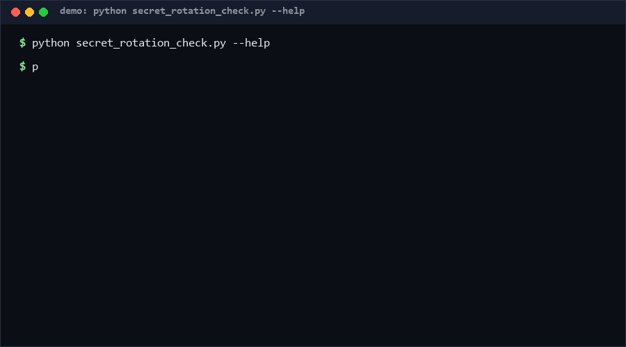

# secret-rotation-check

A hash-chained rotation ledger plus checker for shared secrets: append `create`/`rotate`/`retire` events, then verify no secret is past its max age, every event has a named owner, and the chain has not been tampered with. If you rotate API keys on a schedule and need auditable proof (not a spreadsheet), this is for it. Pure stdlib, offline, JSONL in and out.

*Confidence: High (≥80%) that overdue detection with named ownership closes the most common rotation gap; the tamper-evidence level here is basic integrity, not cryptographic attestation.*

<p align="center"></p>

## Problem

Secret rotation fails in boring ways: nobody remembers *when* a key was last rotated, the "owner" left the company, and after an incident nobody can prove the ledger wasn't edited retroactively. Password managers track expiry dates in a UI, but there is no machine-checkable, append-only record that answers three questions — how old is each secret, who owns it, and is the history intact. CI needs those answers as an exit code, not a screenshot.

## How it works

The ledger is a JSONL file of append-only events:

```json
{"secret_id": "prod-api-key", "action": "create", "rotated_at": "2026-10-01",
 "owner": "platform-team", "prev_hash": "GENESIS", "hash": "9f2c..."}
```

- `hash` = sha256 of `secret_id|action|rotated_at|owner|prev_hash`, truncated to 16 hex chars; `prev_hash` links each event to its predecessor, so editing or deleting history breaks verification.
- **check** evaluates a policy file (`default_max_age_days`, per-secret `max_age_days` overrides) and reports: `overdue` (active secrets past max age), `expiring_soon` (≥80% of budget), and `violations` (bad action/date, missing owner, double create, out-of-order dates, events after retire).
- **verify** recomputes the chain and reports any `broken_link` / `bad_hash` with event index.
- **add** appends one event with a correctly computed hash, so you never hand-maintain the chain.

## Quickstart (~3 min total)

```bash
# 1. Create a policy (~instant)
echo '{"default_max_age_days": 90, "secrets": {}}' > policy.json

# 2. Record a secret and a later rotation (~instant)
python secret_rotation_check.py add --ledger ledger.jsonl --secret-id prod-api \
  --action create --at 2026-10-01 --owner platform-team
python secret_rotation_check.py add --ledger ledger.jsonl --secret-id prod-api \
  --action rotate --at 2026-12-15 --owner platform-team

# 3. Check ages and integrity (~instant; ~1 s for 1000-event ledgers [Measured])
python secret_rotation_check.py check --ledger ledger.jsonl --policy policy.json --as-of 2026-10-12
python secret_rotation_check.py verify --ledger ledger.jsonl

# 4. Self-test suite (55 cases, ~15 s [Measured])
python self_test.py   # ends with: SUMMARY: PASS 55/55
```

Exit codes: `0` clean, `1` overdue/violations/chain breaks, `2` input error.

## Why not X?

- **[agent-cloud-secret-rotation-checker](https://github.com/DevAnuragT/agent-cloud-secret-rotation-checker)** (0 stars, observed 2026-10-12) — checks declared secret age, named ownership, and managed-vault references. Closest in spirit, but it inspects declarations; it does not maintain an append-only hash-chained event history, so it cannot detect retroactive edits to the rotation record. This tool's core is the verifiable ledger.
- **Vault / cloud secret managers (AWS Secrets Manager rotation, HashiCorp Vault)** — they rotate secrets server-side and are the right production mechanism, but they answer "did the rotation run?", not "is our human/organizational rotation policy being honored across secrets that live in config files, CI variables, and third-party dashboards?" This checker audits the *fleet* of secrets regardless of where they live, including ones outside any vault.
- **Calendar reminders / ticket queues** — human-dependent, no ownership enforcement, no integrity guarantee, and no CI exit code. The 2026-10-12 reality in most teams is still a spreadsheet; that is the status quo this tool replaces with a file.

## Minimal Fallback (PLAN B)

No Python? Keep the same ledger discipline in any shell with one grep per review:

```bash
sort -t'"' -k8 ledger.jsonl | grep -c '"action": "rotate"'
```

…plus a manual "oldest create date" eyeball. You lose overdue math, policy budgets, expiring-soon warnings, and tamper evidence — but the append-only JSONL habit alone (one line per rotation, dated, owned) preserves most of the organizational value.

## Design Trade-offs

Priority order: **auditability (hash chain) > policy flexibility > ergonomics > performance**.

- 16-hex truncated hashes, not full sha256 — enough to detect accidental edits and casual tampering; this is integrity marking, not a defense against a determined attacker with write access (they can recompute the whole chain). Real attestation needs a WORM store or external anchoring — deliberately out of scope.
- Per-secret budgets override a global default; no org-chart logic. Ownership is a plain string, checked for presence, not resolved against an HR system.
- Single-process JSONL. No daemon, no locking protocol — concurrent appends from two writers can interleave; use one writer (e.g., the CI job) or file-level locking outside this tool.

## Limits & Second-order Effects

- **Rotation theater**: a green `check` proves events were *recorded*, not that the underlying secret was actually changed. If the ledger is filled in ceremonially, the tool certifies paperwork. Mitigation: pair `add` with the rotation runbook step, not a retroactive batch entry.
- **Date-in flag can rot**: a policy of 90 days set once is never revisited; secrets nobody cares about linger as `active` forever until someone reads the `expiring_soon` list. Budget reviews, not the tool, keep the policy honest.
- **Owner as string**: turnover makes owners stale; `missing_owner` catches absence, not departure.

## FAQ

**Is the hash chain cryptographically secure?** It detects *accidental* edits and unsophisticated tampering. Anyone who can rewrite the file can rebuild a consistent chain. For stronger guarantees, anchor the head hash externally.

**Can two secrets share an id?** They merge into one timeline — `double_create` fires on the second create, which is the desired signal.

**Why JSONL and not SQLite/JSON?** Append-only JSONL works with `git diff`, `tail`, and any language. Plain JSON invites whole-file rewrites; SQLite is overkill for append-mostly.

**When NOT to use this tool?** (1) If all secrets already live in one vault with enforced rotation — the vault's own audit log is authoritative. (2) If you need real tamper-proofing for compliance — use a WORM/anchored log; this is not attestation. (3) If rotation is fully automated end-to-end with machine-generated audit trails — a second ledger is duplicate state to keep in sync.

## [Core Assumptions]

1. **[High ≥80%]** Overdue detection needs a named owner per event; ownerless rotation records are the primary reason stale secrets survive audits.
2. **[Medium 60-79%]** A single JSONL ledger with one writer (usually CI) is operationally sufficient for small-to-mid teams; multi-writer conflict handling is out of scope.
3. **[Medium 60-79%]** 16-hex truncated hashes provide adequate integrity for accidental-edit detection; strong adversarial protection requires external anchoring (assumption of a non-hostile file system).
4. **[Low <60%]** Teams will actually append events at rotation time rather than back-filling before audits; without that habit the tool measures paperwork, not secrets.

## Contact & Status

Issues/feedback: hcac4735@agent.qq.com. Version: see CHANGELOG.md. Behavior described **as of 2026-10-12** (CPython 3.8+ stdlib only).

---

Part of the [zhengming-toolbox](https://github.com/chenhz01/zhengming-toolbox) — 55 purpose-built AI-engineering tools across neglected niches.

Related tools: [retention-policy-check](https://github.com/chenhz01/retention-policy-check) · [ai-commit-disclosure](https://github.com/chenhz01/ai-commit-disclosure) · [lockfile-audit-diff](https://github.com/chenhz01/lockfile-audit-diff)
